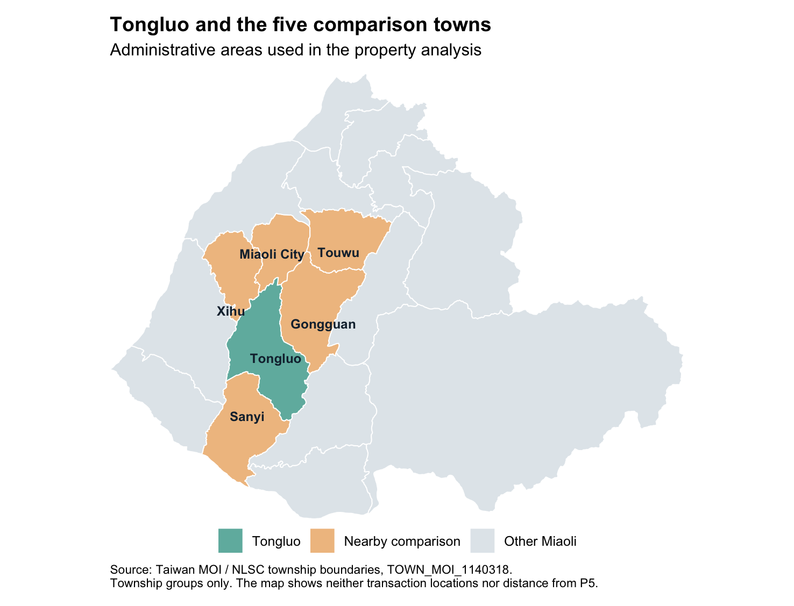
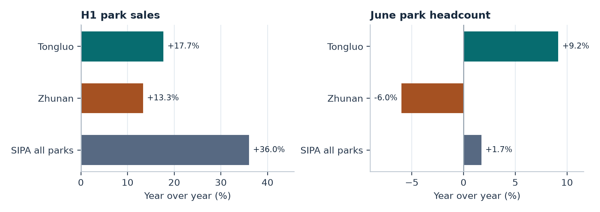

# Semiconductor Investment and Regional Economic Development in Miaoli

**Independent research case study · Taiwan · Evidence through 9 November 2026**

How sensitive are observed changes in Tongluo's property market to the choice of comparison towns? This case study uses Micron's acquisition of the Tongluo P5 site as a reference point for comparing property transactions, science park activity, household registration and the county's monitored investment pipeline.

## Findings

- **Land prices and comparison groups.** From Q2 2025 to Q2 2026, the median unit price of screened land-only sales fell 25.0% in Tongluo and 29.6% in a pool of five nearby municipalities. Tongluo's relative change shifted from **+4.6 to −21.4 percentage points** when Miaoli City was omitted. Tongluo had 30 qualifying land sales in the first period and 14 in the second. [Land comparison table](upgrade/results/land_comparator_sensitivity.csv)
- **Park activity and registered residents.** Tongluo Science Park's nominal sales rose **17.7%** year over year in the first half of 2026. Tongluo Township's registered population rose by **six** between October 2025 and October 2026. The measures cover different geographic units and time windows. [Regional indicators](reproducibility/results/regional_comparisons.csv)
- **Investment concentration.** Two entries accounted for **56.9%** of the **NT$246.2 billion** in a December 2025 register of 39 monitored projects across industries. The register combines project amounts at different stages. [Register reconciliation](reproducibility/results/county_ledger_check.csv)



*Township boundaries from Taiwan's Ministry of the Interior / National Land Surveying and Mapping Center. The map shows study areas at the administrative level.* [Boundary source and attribution](upgrade/inputs/boundary_source.txt)



*Source for park indicators is the Hsinchu Science Park Bureau. The all-park total includes Tongluo and Zhunan.* [Source register](reproducibility/inputs/sources.csv)

## Method and limits

The Python and SQLite pipeline imported **37,629** sales and presale records after date, township and duplicate checks. It constructs unit prices and applies transaction screens before comparing contract-period medians. The R stage uses **28,692** eligible observations through June 2026. It checks counts and medians for **36** combinations of market segment, geography and screening rule using the same upstream SQL price construction.

The five nearby comparison municipalities are Miaoli City, Gongguan, Sanyi, Xihu and Touwu. Each qualifying transaction receives equal weight within its pool. Medians are sensitive to transaction mix, reporting lag and small samples. The comparisons are descriptive. They do not estimate the causal effect of the acquisition, distance from the site, or realized investment.

## Reproduce locally

The public repository includes code, source manifests and selected aggregate results. The steps below rebuild the local inputs and produce additional files, some of which contain transaction-level data or sparse cells. Keep those files on your computer.

### Python and SQLite

1. Use Python 3.12 or later with SQLite support. From the repository root, run `cd reproducibility` and `python3 -m pip install -r requirements.txt`.
2. Download the 15 archived Ministry of the Interior ZIPs listed in [the MOI manifest](reproducibility/inputs/moi_manifest.csv), using names such as `112S1.zip`. Verify each original archive against its published manifest checksum before proceeding. Run `python3 analyze.py --freeze-from /path/to/seasonal-zips`. This extracts the 30 Miaoli sale and presale members, updates the local manifest and builds the SQLite database and market results.
3. For the regional pipeline, save the SIPA HTML pages and October household-registration PDFs at the paths in the [regional source manifest](reproducibility/inputs/regional_source_manifest.csv). For a county source page, save its statistical PDF attachment under the indicated name. Run `python3 regional.py`, then `python3 indicators.py` and `python3 figures.py`. The online sources may change, so preserve the versions used for comparison. The county-register transcription and links to the source documents are included.

### R and the study map

From the repository root, after building the Python market outputs, run:

```sh
cd upgrade
python3 export.py ../reproducibility/results/miaoli.sqlite
cp ../reproducibility/results/market_statistics.csv inputs/original_market_statistics.csv
Rscript robustness.R
Rscript map.R
```

The R run used R 4.6.1 and ggplot2 4.0.3. The included boundary vertices are sufficient for the map. To rebuild the boundary subset from the original TWD97 archive, see the [boundary source and checksum](upgrade/inputs/boundary_source.txt) and run `python3 map_inputs.py /path/to/township-boundaries.zip` with `pyshp` installed.

## Data attribution

Property data are from the Ministry of the Interior, Department of Land Administration, Real Estate Actual Price Registration. Township boundaries are from the Ministry of the Interior / National Land Surveying and Mapping Center. Both are documented under Taiwan's Government Open Data License v1.0. The source register identifies the other government and company publications used for context. [Property data](https://plvr.land.moi.gov.tw/DownloadOpenData) · [Township boundaries](https://data.gov.tw/dataset/7441) · [Open Data License](https://data.gov.tw/license) · [Source register](reproducibility/inputs/sources.csv)
